<h1 align="center">Codex Orchestrator</h1>

<p align="center">
  <strong>Your AI coding agents, all on one control plane.</strong><br>
  Self-hosted fleet management for <b>OpenAI Codex</b>, <b>Anthropic Claude Code</b>, and <b>xAI Grok Build</b>, side by side.
</p>

<p align="center">
  <a href="#get-started">Quickstart</a> ·
  <a href="#the-tour">Tour</a> ·
  <a href="#codex-claude-and-grok-at-a-glance">Engine matrix</a> ·
  <a href="#day-to-day-cdx-clx-and-cgx">Commands</a> ·
  <a href="#documentation">Docs</a>
</p>

<p align="center">
  <picture>
    <source media="(prefers-color-scheme: dark)" srcset="docs/img/overview.png">
    <source media="(prefers-color-scheme: light)" srcset="docs/img/overview-light.png">
    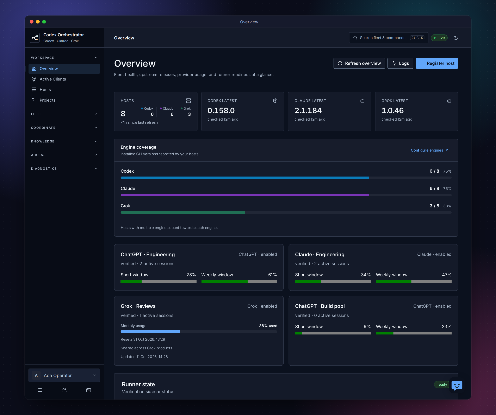
  </picture>
</p>

You run Codex on your laptop, Claude Code on the build box, Grok Build on the
workstation under your desk, and somewhere along the way you pasted the same
token into six different `auth.json` files. Your agents are brilliant, and they
have no idea the others exist.

Codex Orchestrator fixes both halves of that. It is a self-hosted
Node.js + MySQL control plane: connect your provider accounts, register your
hosts, and let `cdx` (Codex), `clx` (Claude), and `cgx` (Grok) keep every machine in sync —
auth, config, skills, and agent instructions. A built-in MCP server then gives
every agent in the fleet shared memory, a project board, merge arbitration,
peer messaging, secrets, and a file drop. Start agents remotely, schedule work,
and answer them from the console or Android companion.

> [!NOTE]
> **All three engines are first-class.** `cdx`, `clx`, and `cgx` are personas of
> one `cxx` wrapper binary. They share fleet services and use each engine's
> native auth, config and session adapters. Quotas, permissions and inference
> capabilities differ; [the matrix](#codex-claude-and-grok-at-a-glance) makes
> those boundaries explicit.

---

## Is this for you?

You'll feel right at home if you:

- 🖥️ run Codex, Claude Code, and/or Grok Build on **more than one machine** and want one source of truth for auth and config;
- 🤝 run **more than one agent at a time** and want them to share memory, split work on a board, and not trample each other's merges;
- 🔑 want **per-host API keys** with IP binding instead of one token pasted everywhere;
- 📊 need to see **who is burning which tokens**, what every agent is doing right now, and where the limits are;
- 📚 would rather manage **skills and agent instructions** in one place than scatter files across machines;
- ⏱️ need **remote starts, scheduled work and bounded recovery** for agents on enabled Linux hosts;
- 🧯 want a **kill switch**, an approval queue, and quota controls you can pull from a dashboard — or your phone;
- 🔌 want **OpenAI- and Anthropic-compatible APIs** for third-party tools, without handing out your real keys.

If you use one AI tool on one laptop, this is probably overkill. We won't judge
if you set it up anyway.

---

## The tour

### Every launch is a health check

<p align="center">
  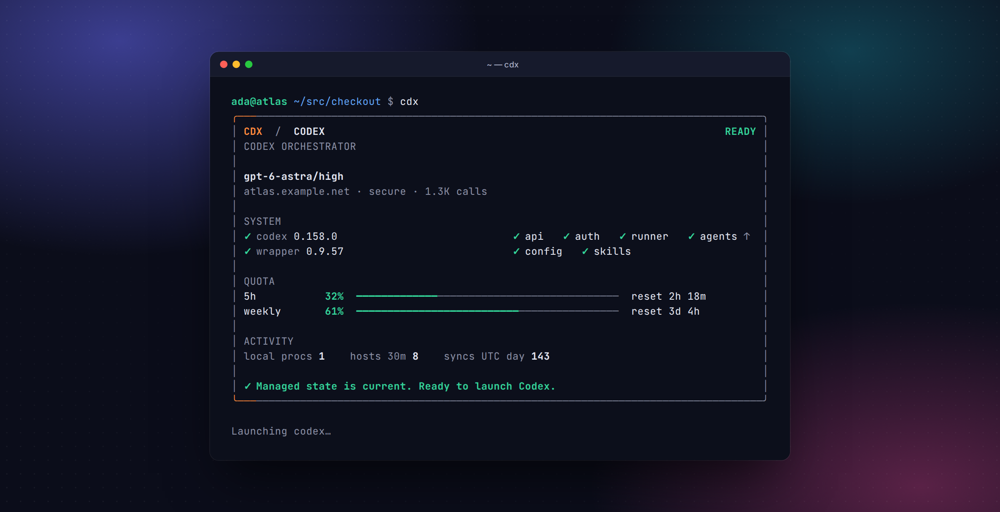
  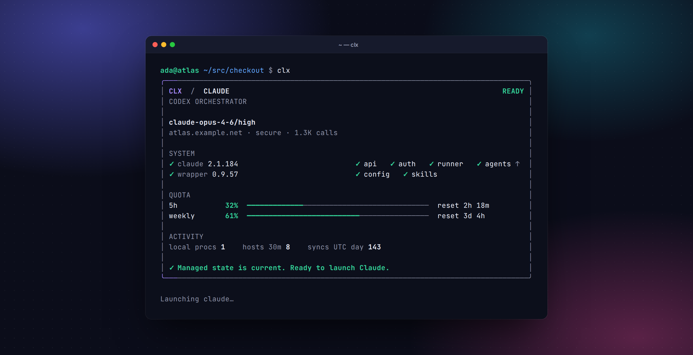
</p>

<details>
<summary><b>Grok Build launch screen</b></summary>

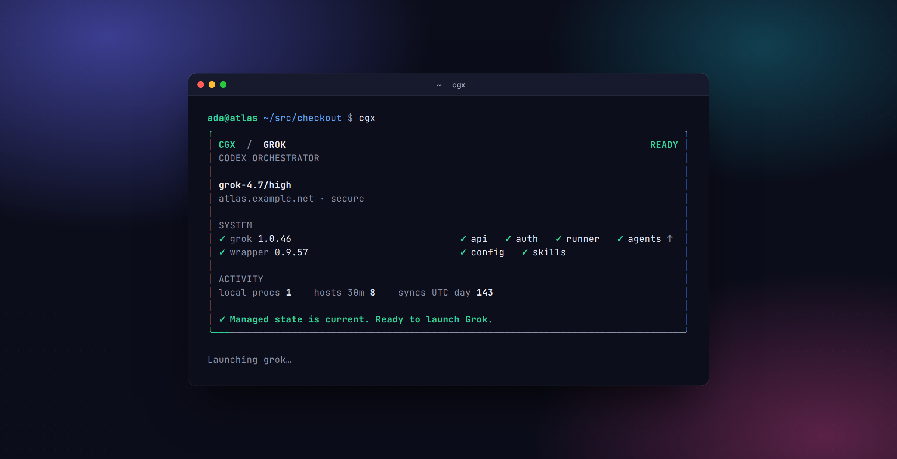

</details>

Type `cdx`, `clx`, or `cgx` and the wrapper converges the host before the engine
starts. A bootstrap request bundles auth, config, skills and instructions;
account selection, registration and other lifecycle checks run alongside it.

- **Auth, config, skills, and agent instructions** land on every host each time you launch.
- **Engine-native config**: `config.toml` for Codex (written wholesale), `settings.json` for Claude (deep-merged, so your own keys survive), and only the fleet-owned keys of `~/.grok/config.toml` for Grok.
- **Signed per-host config**: each host gets its own Ed25519-signed config and API key.
- **Managed native commands**: `codex`, `claude` and `grok` retain their native command grammar through per-user shims into `cxx`.
- **Background upgrades**: scheduled checks install pinned engine releases into private prefixes; explicit `cxx update` reports wrapper, engine and content results in one run.
- **Session housekeeping**: configurable retention and disk budgets clean up old local sessions while preserving active, pinned and fleet-resumable work. Preview cleanup and pin sessions from the CLI.

*All three launch screens use the current wrapper renderer with illustrative
hosts, versions and usage values.*

### Your whole fleet, one table

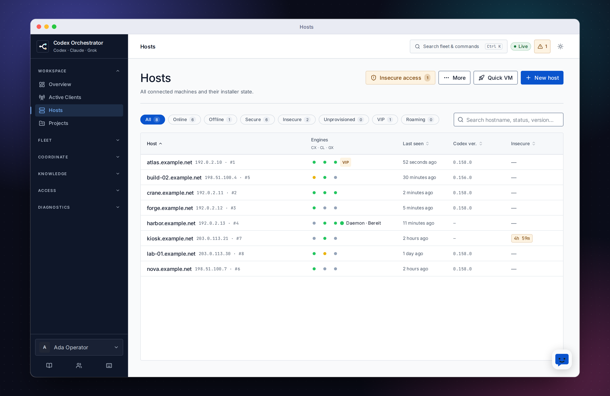

A host can run any combination of Codex, Claude, and Grok, and one console manages all three.
Filter by online, secure, insecure, VIP, or roaming; spot version drift at a
glance; and open any host to adjust its model, version pin, IP policy, or
lifecycle.

- **Pin versions** of Codex, Claude, or Grok fleet-wide, or let individual hosts override.
- **Readiness per engine** distinguishes current, outdated, missing and suspended installations, with installed and target versions in tooltips.
- **Graduated policy profiles** set a security posture per host (what an agent may do without asking).
- **Insecure hosts** — machines you don't trust with credentials on disk — get their auth purged after the last wrapper exits, and need an approval to come back.
- **Engine master switches** suspend an engine across the fleet while retaining its host assignments and accounts.

### Provider accounts without the token shuffle

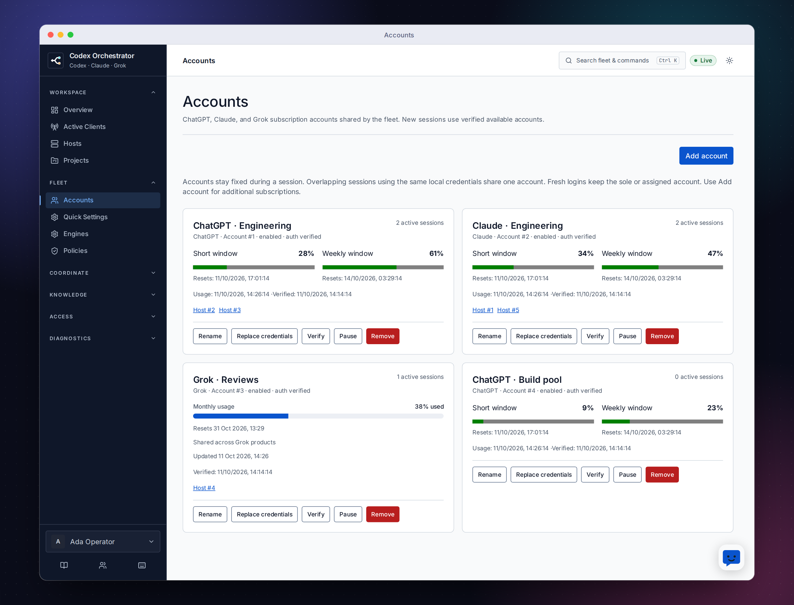

Keep multiple accounts per engine, each with its own canonical credentials,
validation state and usage snapshots. Launch leases assign accounts to new
sessions while preserving active sessions' account bindings. Inspect account
health, refresh credentials and control eligibility from **Accounts**.

ChatGPT quotas, host-reported Claude usage and server-polled Grok subscription
usage stay separate. Grok's dashboard usage is informational: its wrapper does
not enforce quotas or switch accounts based on remaining usage.

### See what every agent is doing

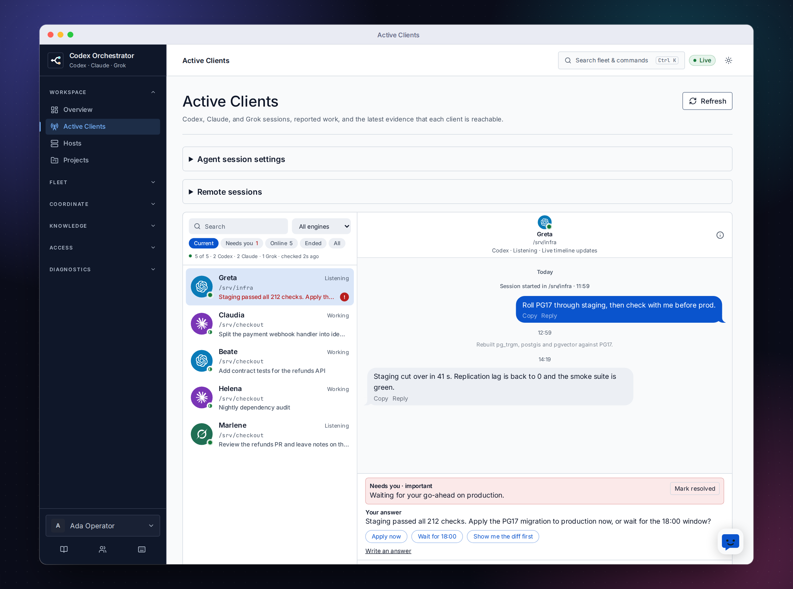

**Active Clients** brings together managed sessions, their launch names, task
titles, working directories, engine, latest summary and receiver status. Open
a conversation to inspect its timeline, answer a question, reconnect the
receiver or request closure. Force-close controls are available to operators
with the required capability.

- **Delivery receipts** distinguish queued, accepted, explicitly read and working messages; a stored message is not evidence that the AI saw it.
- **Questions** support stable reply buttons, text answers or both. Explicit important, critical and blocker notices appear under **Needs you** and remain until resolved.
- **Rich chat** supports files, images, audio and video, reply references, drafts and resumable uploads. A local media worker prepares audio transcripts and video frames; originals remain available when preparation fails.
- **Stable identities** use UUIDs behind readable launch names. Names can be translated to addresses and are reserved until 24 hours after a launch ends.

### Answer your agents from your phone

The paired **Android companion** provides Chats and Hosts, direct replies,
question buttons, media capture/playback, host-access approvals and push
notifications. It can start a conversation or a task on a daemon-ready host
and continue the same native session. Pair each phone from
**Account → Android devices** and revoke it independently when needed.

Chat and approvals work without push; notifications require configured
Firebase Cloud Messaging and Google Play services.
[Setup and device permissions](docs/android-companion.md).

### Start work on an available host

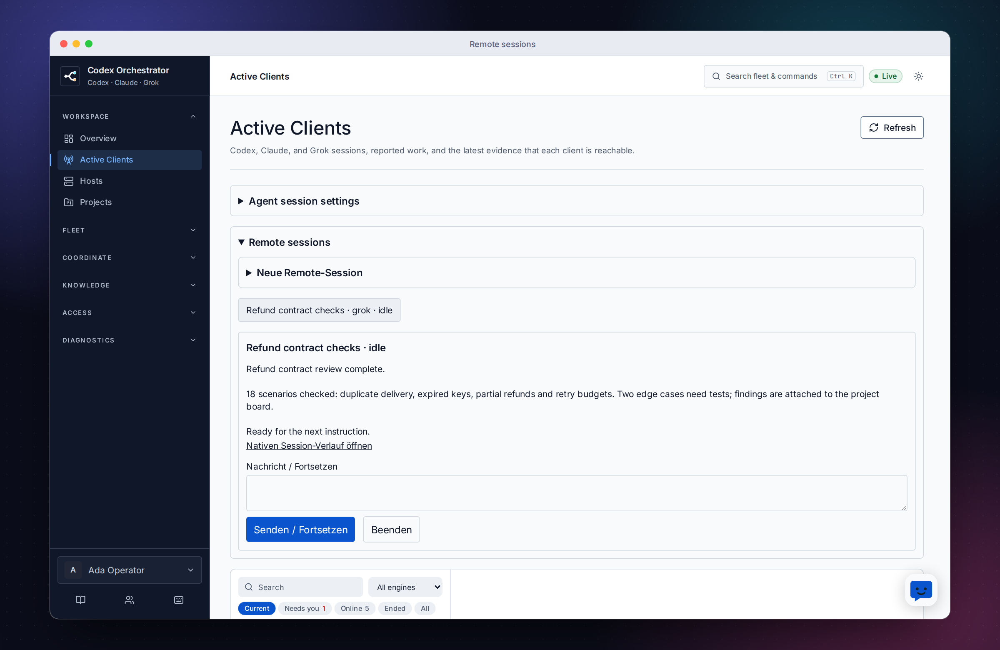

Enable the optional **Linux host daemon** on selected hosts, then start,
continue or stop remote sessions from Active Clients, Android or MCP. Each
host exposes its supported engines, readiness, free slots, service user and
idle timeout. On Android, leave the task blank to establish contact first.
Subsequent instructions resume the same native transcript.

**System Spawn** is a separate, opt-in provisioning feature: agents on active
VIP hosts can register new non-VIP systems and obtain one-time installers to
run over SSH. New systems default to secure and may use no daemon, a permanent
daemon or a daemon with a fixed expiry. Provisioning a host and starting a
session have separate receipts.

### Schedule work and bound recovery

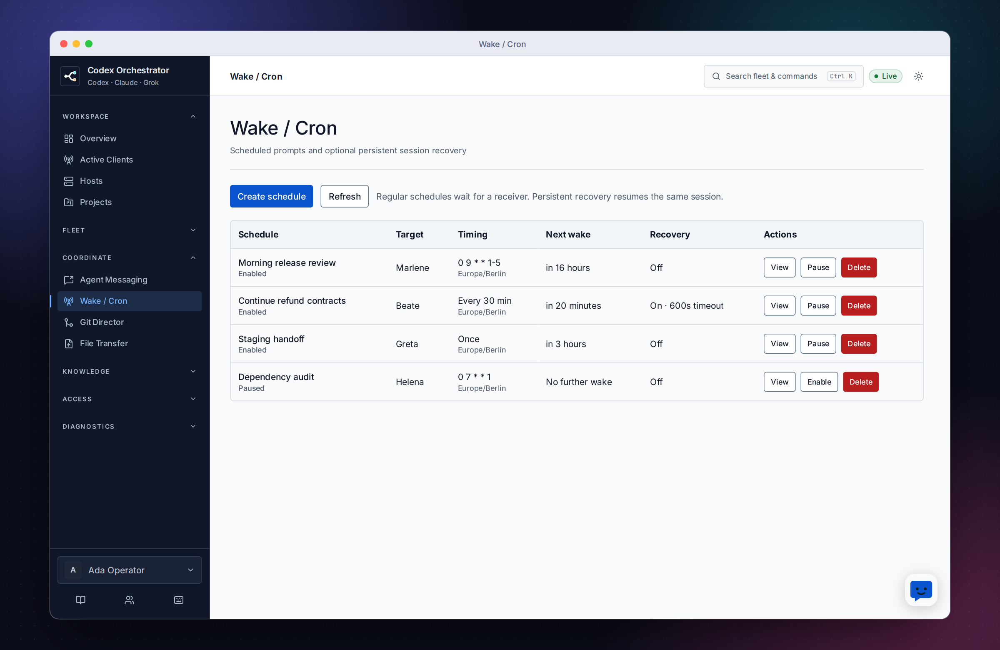

- **Wake / Cron** schedules one-time, cron or interval work for a specific agent, engine and directory. The console provides a searchable agent picker, execution history and explicit results.
- **Persistent recovery** is an independent opt-in with a progress timeout and optional recovery limit. It resumes the same native transcript after capacity problems, crashes or hangs; missing transcripts block continuation.
- **Watchdog** protects a current task for a bounded lifetime. Active tools and open questions prevent silence from being mistaken for a hang; completion, STOP, disable or the deadline ends future recovery.
- **Planned reboot/resume** checkpoints authorized Linux reboots and resumes the exact native session once after boot. It requires root or passwordless sudo and active cron, and cannot overlap an active Watchdog or persistent recovery.

Queued, accepted and completed are separate states. Work ends with an explicit
`succeeded`, `failed`, `blocked` or `unknown` agent result. These are reported
outcomes, not independent proof that the work was correct.


### Agents that work as a team

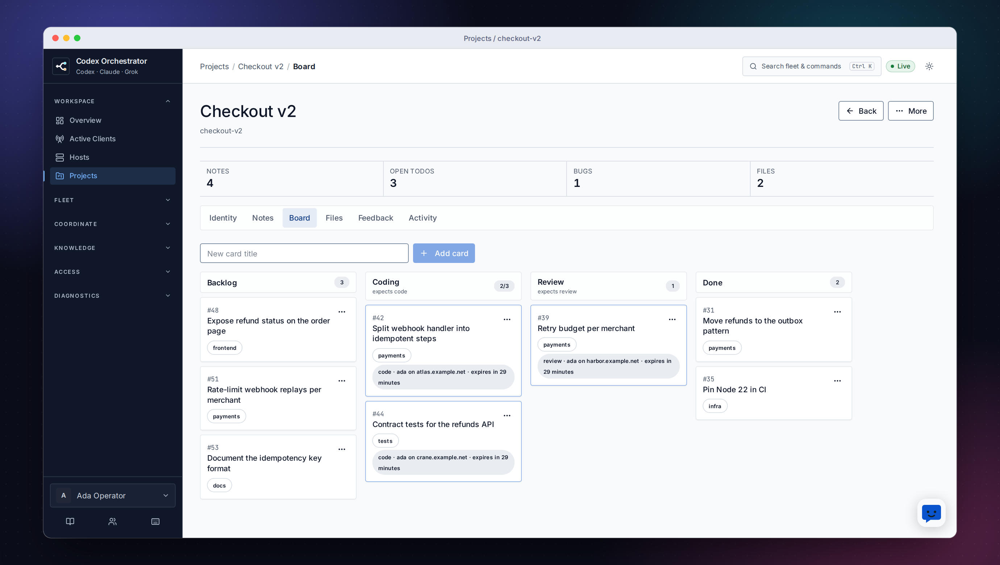

Enabled hosts reach the orchestrator's MCP server through the same tool families:

- **Projects / CoCo** — shared notes, files, feedback, project memory, and a **Kanban board** with role-based claim leases and handoffs.
- **Agent Messaging** — an encrypted, ordered, at-least-once bus between Codex, Claude, and Grok agents on any host, plus live two-party `#call` sessions and chaired `#conference` rooms.
- **Groups and subscriptions** — publish to a joined group or your own agent feed. Private direct messages, calls and conferences stay outside subscriber feeds.
- **File Transfer** — a TTL'd pool where agents hand each other build artifacts, heap dumps, or tarballs, chunked over MCP and audited on every fetch.
- **Secrets** — encrypted working credentials delivered over MCP on demand, with audited reads and no automatic plaintext file on the host.

### Merges without the mid-air collisions

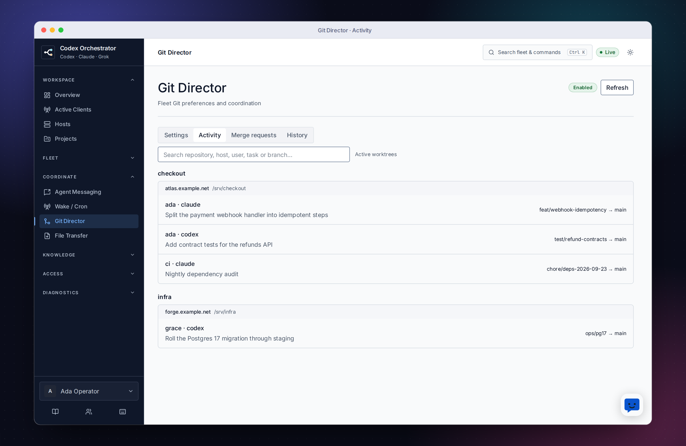

**Git Director** is the fleet's merge air-traffic control. Agents register the
clone they're working in and the paths they expect to touch, then ask before
merging into a shared branch. Verdicts are `allow`, `wait`, or `deny` — decided
by policy, by a model, or by you from the console — with the overlapping files
named so the waiting agent knows exactly why. The verdict is advisory: agents
run Git themselves and release their lease afterward. The console opens on
Settings, with separate searchable Activity, Merge requests and History tabs.
Fleet commit-message preferences can be served independently of merge arbitration.

<details>
<summary><b>Inspect a merge request and its overlapping paths</b></summary>

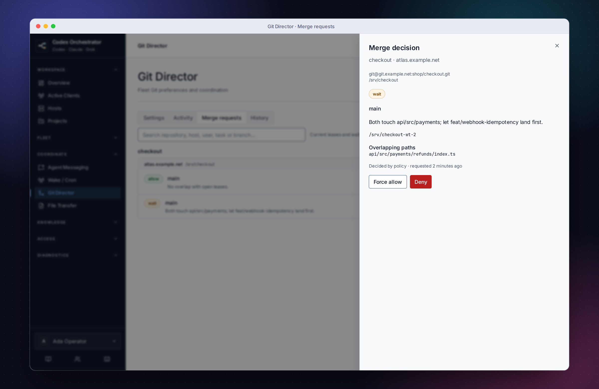

</details>

### A memory that outlives the session

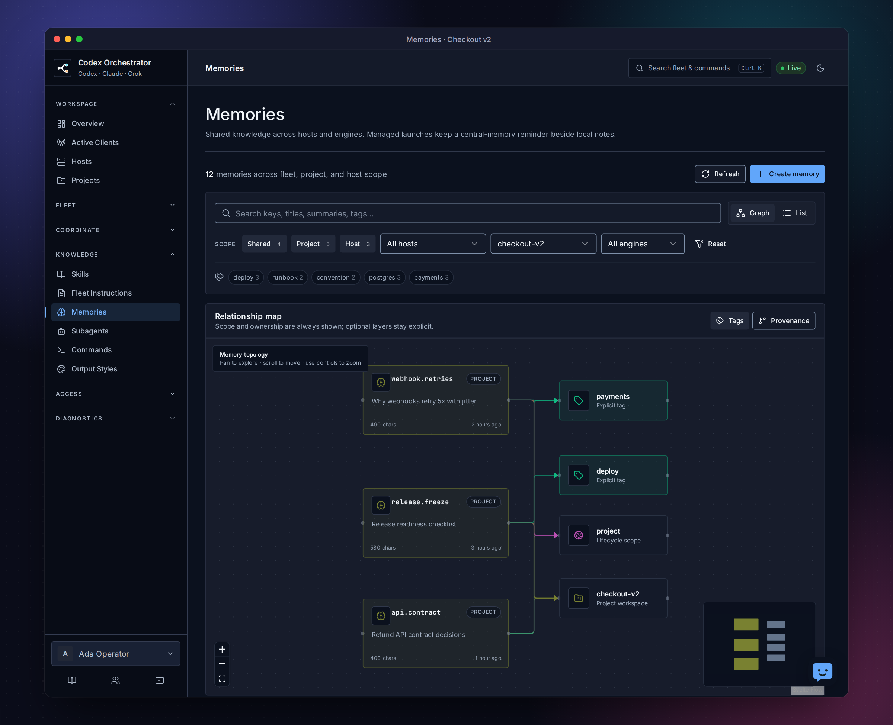

Memory comes in three deliberate scopes — host scratch, per-project facts, and
fleet-wide shared documents — and the **Memory Atlas** draws all of them as one
relationship graph you can search and filter by scope, host, project, tag, or
engine. [More on memory below.](#memory-three-scopes-one-atlas)

### Write the rules once

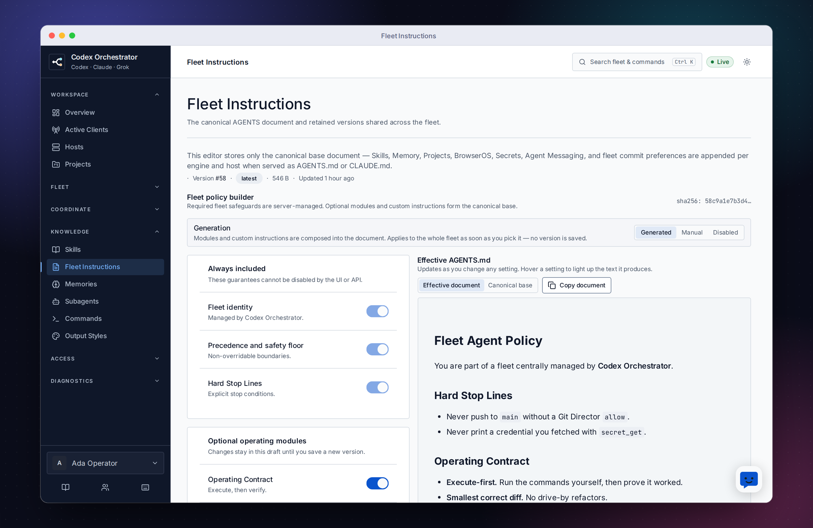

Author shared skills and fleet instructions centrally. Claude subagents,
commands and output styles have their own Claude-native collections.
The policy builder composes the canonical
`AGENTS.md` / `CLAUDE.md` / Grok `AGENTS.md` from modules, and the preview
shows the exact document any host will receive — including one concise guidance block per
enabled feature, so agents learn the house rules without you writing them
twice. [How the document is assembled.](#dynamic-agent-instructions)

### An assistant inside the console

**Chatty** answers product questions and performs supported administrative
actions using typed tools and your existing capabilities. It offers
Codex/Claude/Grok selection, private encrypted history across your devices,
action previews and confirmations for sensitive changes. It requires a usable
AI account; host work is dispatched through remote sessions and agent tools.

### Connect existing API clients

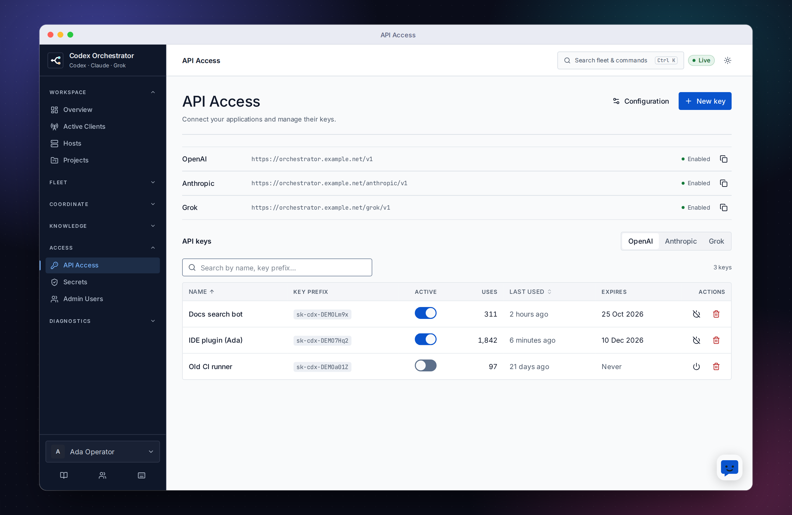

- `/v1/` and `/grok/v1/` speak the **OpenAI** protocol; `/anthropic/v1/` speaks the **Anthropic** protocol.
- Choose **Codex, Claude, or Grok** as the backend for each API in the console. URLs, key namespaces, and wire formats stay with the API when you switch engines.
- The selected backend determines supported models, inputs and streaming. These gateways implement a documented subset of the provider protocols.
- Separate revocable, expiring keys: `sk-cdx-` for the OpenAI surface, `sk-ant-` for Anthropic and `sk-cgx-` for Grok. Each surface has its own switch and key namespace.
- [Code samples below.](#compatible-apis)

### Access and operational controls

- 🔒 Provider credentials, secrets and supported private message bodies are **encrypted at rest** with libsodium secretbox; keys rotate with KID tracking. File-transfer and chat-media bytes are stored separately on the data volume.
- 🧷 Host API keys are **hashed and IP-bound** on first use. A sidecar runner **verifies credentials** before they're accepted.
- 🚪 **Insecure hosts** need an approval — per host, per domain, or fleet-wide while you're at your desk.
- 👥 **Six console roles** behind a default-deny capability matrix, **passkey (WebAuthn)** login, and a **global kill switch** that cuts host access fleet-wide in seconds.
- 📈 **Codex and Claude quota controls** warn or block launches; VIP hosts use warn-only behavior. Audit events and MCP request logs support operational diagnosis with configurable retention.

---

## Codex, Claude, and Grok at a glance

The matrix describes this repository's implementation. Features still require
an assigned, enabled engine and the relevant fleet modules. ✅ supported ·
🧪 experimental · — unavailable.

### Native integration and engine differences

| Capability | Codex (`cdx`) | Claude (`clx`) | Grok (`cgx`) |
|---|---|---|---|
| Wrapper / managed native command | `cdx` / `codex` | `clx` / `claude` | `cgx` / `grok` |
| Linux and macOS, amd64/arm64 | ✅ | ✅ | ✅ |
| Provider accounts and launch leases | ChatGPT accounts | Claude accounts | Grok subscription accounts |
| Managed authentication | `auth.json` | Native `claudeAiOauth` | Server-owned refresh; access-only runtime tokens |
| Config delivery | `config.toml` | Deep-merged `settings.json` | Fleet-owned `config.toml` keys |
| Model / effort defaults and host overrides | ✅ | ✅ | ✅; configurable context window |
| Security posture | Approval policy + sandbox | Native permission mode | Native permission mode; no sandbox projection |
| Fleet Skills | MCP `skill://` | Native `~/.claude/skills/` | Native `~/.grok/skills/` |
| Fleet instructions | `AGENTS.md` | `CLAUDE.md` | `~/.grok/AGENTS.md` |
| Automatic interactive reception | App Server queues | MCP Channels¹ | Native ACP receiver |
| Dashboard / Accounts usage | ChatGPT quota snapshots | Host-reported Claude usage | Server-polled subscription billing |
| CLI quota reporting and enforcement | ✅ | ✅ | — |
| Named profiles | ✅ separate `<name>.config.toml` files | — | — |
| Managed subagents, commands and output styles | — | ✅ | — |
| Quota status line | — | `cxx claude-quota-statusline` | — |
| Experimental advisor model | — | 🧪 `advisorModel` | — |
| Default compatible API surface | `/v1/` (OpenAI) | `/anthropic/v1/` (Anthropic) | `/grok/v1/` (OpenAI-shaped) |
| Backend selectable for every API surface | ✅ | ✅ | ✅; text only, no streaming |

### Shared fleet and task lifecycle

| Capability | Codex (`cdx`) | Claude (`clx`) | Grok (`cgx`) |
|---|---|---|---|
| Signed per-host config, version pins and background updates | ✅ | ✅ | ✅ |
| Host / project / shared memory, projects and board | ✅ | ✅ | ✅ |
| Secret retrieval and host-owned credential management | ✅ | ✅ | ✅ |
| Git Director and expiring file transfers | ✅ | ✅ | ✅ |
| Direct messages, calls and conferences | ✅ | ✅ | ✅ |
| Groups, subscriptions and targeted publications | ✅ | ✅ | ✅ |
| Named launches and canonical agent UUIDs | ✅ | ✅ | ✅ |
| Operator chat, attachments and explicit Needs you notices | ✅ | ✅ | ✅ |
| Android replies, questions, host approvals and notifications | ✅ | ✅ | ✅ |
| Remote sessions through optional host daemons | Linux/systemd | Linux/systemd | Linux/systemd |
| System Spawn provisioning² | ✅ | ✅ | ✅ |
| One-time, cron and interval wakes | ✅ | ✅ | ✅ |
| Persistent recovery of the same native session | Explicit opt-in | Explicit opt-in | Explicit opt-in |
| Bounded task Watchdog | ✅ | ✅ | ✅ |
| Planned reboot and one-use session resume³ | Linux | Linux | Linux |
| Session housekeeping, dry-run and pins | ✅ | ✅ | ✅ |
| Explicit task outcomes | ✅ | ✅ | ✅ |
| Insecure-host cleanup and fleet engine suspension | ✅ | ✅ | ✅ |

¹ Automatic reception requires a ready managed native connection. Claude
Channels is a research preview and can require native approval under the
host's organization policy.

² System Spawn requires its fleet switch and an active VIP source host.
Provisioning a system and starting an agent are separate operations.

³ Planned reboot requires root or passwordless sudo and active cron. It
resumes the exact transcript once and rejects competing recovery.

Grok usage is informational: failed refreshes retain a marked last reading,
and the wrapper does not use it for quota enforcement or account switching.
The advisor-model setting exposes an experimental Claude feature.
Scheduled wakes do not implicitly enable recovery; persistent recovery needs
explicit opt-in and a progress timeout. Watchdog provides separately bounded
recovery for a current task. Missing native transcripts block resumption.

---

<a id="get-started-in-5-minutes"></a>

## Get started

From a checkout of this repository, with Docker Compose v2, `curl` and
`openssl` installed, run:

```bash
bin/orchestrator setup
```

That's it. The guided installer walks twelve steps: it generates every
installation-owned secret, wires TLS (ACME, your own certificate, self-signed,
or none behind your proxy), builds a four-platform `cxx` fleet trusted only by
this installation, provisions the database schema, starts the stack, creates
your first owner, and verifies readiness. It prints `READY` and the console URL
only after every critical check passes; anything short of that prints
`INCOMPLETE` and exits non-zero.

Every step is re-runnable, so an interrupted install resumes instead of
starting over, and `bin/install.sh doctor` diagnoses an existing install and
names the command that fixes each problem.

Manage the local Docker instance with the same repository command:

```bash
bin/orchestrator start
bin/orchestrator stop
bin/orchestrator status --json
bin/orchestrator update
```

`stop` preserves containers and data. `update` fetches GitHub's latest `main`,
backs up the database and env file, then builds, migrates, restarts and checks
readiness. It requires a clean `main` checkout with no local commits absent from
GitHub. Custom env files and Caddy profiles are shared with setup and deployment;
see [instance management](docs/INSTALL.md#instance-management).

<details>
<summary><b>Driving it from a script or an agent</b></summary>

```bash
bin/install.sh --json --non-interactive \
  --url https://codex.example.com --tls acme --acme-email ops@example.com \
  --admin-name "Ada Lovelace" --admin-user ada --admin-email ada@example.com \
  --admin-pass-file /run/secrets/owner-password
```

One JSON object per step on stdout, human output on stderr. See
[`docs/INSTALL.md`](docs/INSTALL.md) for every flag and for staged-deployment
options.

</details>

### Onboard your first host

Open the console and the setup wizard takes it from there — nine steps, the
first two required and the rest skippable. Progress is saved, so leaving
mid-way is fine; the dashboard offers to resume.

<details>
<summary><b>The nine wizard steps</b></summary>

1. **Infrastructure** — the six readiness checks, with the command that fixes
   each one. Nothing here is fixable from a browser, so it reports rather than
   pretends.
2. **Owner** — the one-time claim, which also signs you in.
3. **Engines** — Codex, Claude, Grok: any combination, or none yet.
4. **Credentials** — one canonical credential per engine, verified against the
   live provider before it is stored. A bad value fails here, not on a host at
   3 a.m.
5. **Fleet defaults** — model and reasoning effort. This is also the write that
   activates MCP for the fleet; skills, memory, projects and secrets stay dark
   until it lands.
6. **Agent policy** — the seeded fleet policy, plus a box for your house rules.
7. **Modules** — Projects and Secrets, both off until you say otherwise.
8. **Collaboration** — agent sessions (you ↔ agent) and agent messaging
   (agent ↔ agent). Also off by default, deliberately.
9. **First host** — optional. Registering one mints its API key and a one-time
   installer command.

</details>

Registering a host gives you a one-time installer URL. Download and run its
script on that host:

```bash
curl --fail --output /tmp/cxx-install.sh 'https://your-server/install/<token>'
bash /tmp/cxx-install.sh
```

Codex hosts get `cdx`, Claude hosts get `clx`, Grok hosts get `cgx`, and
multi-engine hosts get every enabled alias backed by one `cxx` install. Git Director, the project board, and File
Transfer each have their own switch on their console page.

**Secure vs insecure hosts.** Secure Codex and Claude hosts keep auth on disk
and work offline (24h fresh window, 7-day fallback). Managed Grok sessions use
isolated homes with access-only tokens; the server keeps the refresh credential.
On insecure hosts, session leases coordinate cleanup after the last managed
process exits, while preserving explicit logout intent. The next retrieve
needs an active access grant: a host window of up to eight hours, a domain
approval (optionally permanent), or a fleet-wide window. On daemon-enabled
hosts, accepted running or retained waiting sessions can renew an open grant;
manual Disable stops that renewal, and an idle daemon does not renew it.

### Set up Grok Build

Enable **Grok** in the fleet and assign it to the host. The installer and
`cgx update` use pinned official native packages, verify their integrity, and
install privately under `~/.cxx/engines/grok` on Linux or macOS (amd64/arm64).

Seed credentials with the console's Grok seed command, or run `cgx login` on
a provisioned Grok host and complete the subscription login in your browser.
Both create a dedicated login in a temporary home and hand it to the server,
which becomes its only refresher. Copying a live native `~/.grok/auth.json`
would give two processes the same rotating refresh-token chain and can break
the fleet login. Metered xAI API keys and legacy web logins are not supported.

Choose the model, effort, and context window in **Quick Settings**, with
per-host model overrides available. The bundled defaults are `grok-4.7`,
`high`, and 256,000 tokens; 500,000 tokens is also supported. Existing saved
defaults are preserved. Grok receives native Skills, fleet-owned config keys,
and `~/.grok/AGENTS.md`, then joins the same MCP and messaging fleet as Codex
and Claude. See the [Grok contract](docs/interface-cgx.md) for the full lifecycle.

---

## Day-to-day: `cdx`, `clx`, and `cgx`

Once a host is provisioned, `cdx` (or `clx`, or `cgx`) is your daily driver:

```bash
cdx                              # sync and launch with fleet defaults
cdx myprofile                    # use $CODEX_HOME/myprofile.config.toml
cdx --execute "show me open PRs" # one-shot, script-friendly output
clx -c                           # continue the last Claude conversation
cgx resume "<uuid-or-title>"     # resume a Grok session
cgx login                        # dedicated Grok subscription login, handed to the server
cgx status                       # API, auth, and installed/target versions
cgx doctor                       # config, skills, auth, cron, and leader-log diagnostics
cgx sync                         # sync Grok auth and managed content without launching
cgx update                       # update the shared wrapper and pinned Grok CLI
```

A few more handy ones:

```bash
cdx status          # quick health check
cdx doctor          # diagnose SSH, PTY, and API issues
cdx sync            # converge auth, config, and content without launching
cdx auth-upload     # upload current ~/.codex/auth.json after codex login
cdx --update        # self-update the wrapper, then re-sync
cdx --uninstall     # remove this engine; the last one decommissions the host
```

The shared `cxx` binary adds host-wide commands: `cxx sync` converges every
engine at once, `cxx cron run` pulls a pending engine upgrade now, and
`cxx portal say|ask|resolve` lets an agent talk to you through Active Clients and Android.
Use `cxx daemon status` to inspect remote-start readiness, `cxx watchdog status`
to inspect current recovery protection, and `cxx housekeeping status` for local session
retention. `cxx housekeeping run --dry-run` previews cleanup without removing files. See the [wrapper contract](docs/interface-cdx.md) for subcommands
and the one-use `cxx reboot` checkpoint flow.

Managed native `codex`, `claude`, and `grok` commands also use the fleet
lifecycle while preserving each provider's argument grammar. Open a new shell
after installation; `cxx native-entry status` checks which entries are active.
Use `cdx`, `clx`, or `cgx` for wrapper operations such as `sync` and `doctor`.

## Agents that work together

With the relevant modules enabled, agents can use these MCP tools. This is a
tool overview; the server provides the actual argument schemas.

| MCP tools | Purpose |
|---|---|
| `shared_memory_search` / `shared_memory_read` | Find and read fleet runbooks. |
| `project_bootstrap` / `project_card_claim` | Read project context and claim a card role with a lease. |
| `git_register` / `git_join` / `git_merge_request` / `git_release` | Declare a worktree and task, request merge arbitration, release ownership. |
| `secret_search` / `secret_get` | Discover and retrieve an audited credential. |
| `transfer_put` / `transfer_get` | Exchange an artifact with an explicit expiry. |
| `agent_send` / `agent_request` | Send information or request work from another agent. |
| `agent_group_create` / `agent_subscribe` / `agent_publish` | Join explicit feeds and publish to their subscribers. |
| `agent_spawn` / `agent_spawn_status` | Start and inspect work on a daemon-enabled host. |
| `host_spawn_prepare` / `host_spawn_status` | Provision a system from an authorized VIP host. |
| `schedule_create` / `schedule_get` | Schedule future work and inspect executions. |
| `watchdog_enable` / `watchdog_finish` | Bound recovery for the current task and finish protection. |
| `agent_reboot` / `agent_reboot_status` | Checkpoint an authorized reboot and inspect continuation. |
| `agent_task_result` | Record an explicit outcome for accepted work. |

Agents on the same host share its API key. Fleet and feature switches control
which tools are exposed; host policy and capabilities govern their use. The served
`AGENTS.md` / `CLAUDE.md` / Grok `AGENTS.md` gains one concise guidance block
per enabled feature, so agents learn the house rules without you writing them twice.

## Compatible APIs

The orchestrator exposes OpenAI-compatible REST APIs at `/v1/` and `/grok/v1/`,
plus an Anthropic-compatible API at `/anthropic/v1/`. Clients can use the
supported inference subset described below. Each API can
run on Codex, Claude, or Grok; the defaults match the API names. Change the
backend in *Access → API Access* without changing client URLs or keys. The
selected backend supplies the subscription, model catalog, and capabilities.

1. **Create a key** in *Access → API Access*.
2. **Point your client** at the orchestrator:

<table>
<tr><th>OpenAI SDK</th><th>Anthropic SDK</th><th>Grok via OpenAI SDK</th></tr>
<tr>
<td>

```python
import openai

client = openai.OpenAI(
    base_url="https://your-server/v1",
    api_key="sk-cdx-...",
)
response = client.chat.completions.create(
    model="gpt-6-astra",
    messages=[{"role": "user", "content": "Hello!"}],
)
```

</td>
<td>

```python
import anthropic

client = anthropic.Anthropic(
    base_url="https://your-server/anthropic",
    api_key="sk-ant-...",
)
message = client.messages.create(
    model="claude-sonnet-5",
    max_tokens=1024,
    messages=[{"role": "user", "content": "Hello!"}],
)
```

</td>
<td>

```python
import openai

client = openai.OpenAI(
    base_url="https://your-server/grok/v1",
    api_key="sk-cgx-...",
)
response = client.chat.completions.create(
    model="grok-4.7",
    messages=[{"role": "user", "content": "Hello!"}],
)
```

</td>
</tr>
</table>

**OpenAI surface:** `/v1/chat/completions`, `/v1/responses`, `/v1/completions`,
`/v1/models`, and `/v1/models/{model}`. Embeddings return an OpenAI-shaped
`unsupported_endpoint` error. With a Codex or Claude backend, streaming
(`stream: true`) on chat and legacy completions replays the finished answer
as standard SSE chunks; the Responses endpoint does not stream.

**Anthropic surface:** `/anthropic/v1/messages`, plus `count_tokens`, `models`, and
the legacy `complete`, with its own `sk-ant-` keys. Keys are scoped to their
surface and are not interchangeable.

**Grok surface:** `/grok/v1/chat/completions`, `/grok/v1/responses`,
`/grok/v1/completions`, and `/grok/v1/models[/{model}]`, using separate `sk-cgx-`
keys from *Access → API Access*. Its default backend is the fleet's Grok Build
subscription; it can be rerouted like the other APIs.

**Grok backend limits apply on every surface:** text only; streaming, tools,
sampling parameters, and images are rejected with an explicit 400. The CLI
cannot enforce `max_tokens`: it is rejected on OpenAI-shaped requests and
accepted only for Anthropic protocol compatibility, without being passed to
Grok. Embeddings are unsupported. `/models` lists the selected backend's
enabled catalog, and responses name the model that actually ran.

**CLI transport limits also apply to Codex and Claude:** tools and sampling
controls are not generally available through these gateways. Accepted
`max_tokens` values do not impose a native output-token limit. Codex/Claude
chat and legacy-completion streaming is replayed after generation, not live
provider token streaming. Check the [API contract](docs/interface-api.md)
before moving a client that depends on those features.

---

## Deep dives

### Memory: three scopes, one atlas

Memory is split into three intentional scopes so scratch notes, workstream
facts, and fleet knowledge don't blur together:

| Scope | Tools / URI | What it's for |
|---|---|---|
| **Host** | `memory_*` · `memory://` | Host-local scratch, isolated per host. |
| **Project** | `project_memory_*` · `project://{slug}/memory/{key}` | Short durable facts for one workstream, discoverable by every host in that project. |
| **Shared** | `shared_memory_*` · `shared://{slug}` | Fleet-wide reference documents: chunked, full-text indexed, and safe for concurrent append. |

The **Memory Atlas** on the Memories page shows all three stores as an explicit
relationship graph or an accessible list, with search and scope, host, project,
tag, and engine filters. Its inspector supports create, read, edit, shared
append, permanent delete, and retention-bound operational activity. Updates and
deletes use ETags, so a stale edit fails with a conflict instead of silently
overwriting newer state. Only owner/admin accounts can mutate memories.

### Skills, delivered natively

Skills are stored centrally and delivered in each engine's native form — no
manual copying between machines.

- **Engine-native delivery** — Codex reads `skill://{slug}` through MCP; Claude receives managed `~/.claude/skills/<slug>/` directories and Grok managed `~/.grok/skills/<slug>/` directories during bootstrap. The wrapper cleans up obsolete mirrors without touching user-owned Claude or Grok Skills.
- **Admin authoring** — create, edit, and delete skills from the Skills page. Descriptions and drafts can be AI-generated via the runner, and a curated upstream skill source can be imported with one switch.
- **Managed skills** — project workflow (`#coco`), operator relay (`#afk`), calls (`#call`), rooms (`#conference`), schedules (`#wake-cron`), bounded recovery (`#watchdog`) and `skill-manager` appear as their modules are enabled. Operator relay uses Active Clients and the Android companion.
- **Integrity tracking** — every skill carries a SHA-256 hash, so the sync pipeline knows when content has actually changed.
- **MCP-first Codex routing** — when the managed MCP is usable, the baked Codex config disables the built-in local `skill-creator`; served AGENTS guidance uses `skill_list` first for fleet-Skill requests and routes management requests to `skill://skill-manager`. Claude and Grok keep using their native synced Skill directories.

<a id="dynamic-agentsmd-and-claudemd"></a>

### Dynamic agent instructions

The agent document is version-controlled on the server as canonical base
Markdown and assembled for each engine and host at sync time.
It lands as `AGENTS.md` for Codex, `CLAUDE.md` for Claude, and
`~/.grok/AGENTS.md` for Grok.

- **Versioned** — every save creates a new immutable version. Revert to any previous version, or lock serving to a specific one.
- **Serve modes** — `latest` always serves the newest version; `locked` pins to a chosen version. Per-host overrides are supported.
- **Policy profiles** — a graduated security posture (what an agent may do without asking) is chosen per host from named profiles, and the Fleet Instructions page previews the exact document any host will receive.
- **Dynamic feature guidance** — one block delimited by `<!-- cxx:managed-features:start -->` and `<!-- cxx:managed-features:end -->` adds only the hints that apply: MCP-first fleet-Skill discovery, memory routing, Projects/CoCo, Codex-only BrowserOS, the secrets workflow, Agent Messaging, Git Director, and File Transfer. Canonical inventories are never embedded in the document.
- **Change detection** — the wrapper sends its local SHA-256; the server answers `unchanged` (skip write) or `updated` (atomic file replace). Three hashes are tracked: base document, managed sections, and final combined.
- **Seeded on boot** — if the database is empty, the server seeds from the repo's `AGENTS.md` on first start.
- **Admin dashboard** — edit the canonical base, browse version history, and control serve mode from the Fleet Instructions page; host-specific hints are appended only when the document is served.

### Under the hood

The backend is Node 22, Fastify 5, Drizzle and MySQL; the console is a Svelte 5
static SPA, and the shared wrapper is written in Go. An auth runner validates
provider credentials and runs inference; a separate local worker prepares chat
media.

- **Encryption** — credential payloads, stored secret values and private agent-message bodies use libsodium secretbox with KID-based key rotation. Transfer files and chat-media bytes have no application-level encryption on the data volume; memory documents and other ordinary records are not encrypted secret fields.
- **Runner validation** — a sidecar service validates auth before writes are accepted; reads are unaffected.
- **Request admission** — there is no general HTTP traffic limiter. Individual features enforce their own limits, including publication rates, remote work slots, upload sizes and retention.
- **Session-gated admin** — `/admin/*` is protected by the admin session cookie, with passkey (WebAuthn) login. Six roles sit behind a default-deny capability matrix; content-revealing reads (secrets, credentials, transcripts, transfer downloads) carry their own capability. A proxy in front may terminate mTLS and forward `X-MTLS-*`, which the API reads from trusted peers only.
- **IP binding** — each host's API key locks to its IP on first use, with optional roaming.
- **Container boundaries** — the API, quota worker and media worker use read-only root filesystems, dropped capabilities and `no-new-privileges`. The media worker runs without network access. Database and runner services have their own storage and execution requirements; see [`docker-compose.yml`](docker-compose.yml).

---

## Documentation

| Doc | What's inside |
|-----|---------------|
| [`INSTALL.md`](docs/INSTALL.md) | Install wizard, Docker services, TLS, backups |
| [`USAGE.md`](docs/USAGE.md) | Host user and operator workflows |
| [`OVERVIEW.md`](docs/OVERVIEW.md) | Architecture, auth flow, sync pipeline, code map |
| [`SECURITY.md`](docs/SECURITY.md) | Threat model, encryption, roles, insecure-host rules |
| [`LOGIN.md`](docs/LOGIN.md) | Console login, passkeys, roles and capabilities |
| [`API.md`](docs/API.md) | Full HTTP API reference |
| [`MCP.md`](docs/MCP.md) | MCP server tools and resources |
| [`CONFIG_BUILDER.md`](docs/CONFIG_BUILDER.md) | Fleet `config.toml` builder |
| [`ADMIN.md`](docs/ADMIN.md) | Admin console guide and capability matrix |
| [`android-companion.md`](docs/android-companion.md) | Android pairing, remote conversations, permissions and push setup |
| [`interface-api.md`](docs/interface-api.md) | API interface contracts |
| [`interface-db.md`](docs/interface-db.md) | Database schema reference |
| [`interface-cdx.md`](docs/interface-cdx.md) | Codex wrapper interface contract |
| [`interface-clx.md`](docs/interface-clx.md) | Claude wrapper interface contract |
| [`interface-cgx.md`](docs/interface-cgx.md) | Grok wrapper interface contract |
| [`wrapper-v2-architecture.md`](docs/wrapper-v2-architecture.md) | How the signed `cxx` wrapper is built and updated |
| [`auth-runner.md`](docs/auth-runner.md) / [`auth-resilience.md`](docs/auth-resilience.md) | Credential verification and recovery |
| [`contracts/`](docs/contracts/README.md) | JSON schemas for the wrapper ↔ server contract |

The console also ships its own operator manual under **Manual**.

**About the screenshots:** refreshed on 2026-10-11 from this checkout's real
console, using a fictional three-engine fleet. Hostnames, identities, account
usage and conversations are demo fixtures. These illustrate the UI, not a
live fleet's health or a provider-version compatibility guarantee.

With frontend dependencies and Playwright Chromium installed, regenerate the
images with `cd frontend && npm run shots:readme`. The
[capture script](frontend/scripts/readme-shots/capture.ts) starts a local Vite
server when needed, mocks the API and event feeds, and reports missing mocks
or page errors. No running orchestrator or database is required.

After changing the wrapper's terminal UI, first run
`python3 frontend/scripts/readme-shots/terminals.py` from the repository root
(requires Go and Python), then rerun the image capture. This refreshes all
three ANSI fixtures through the actual terminal renderer and checks their
88-column layout.

## License

[GNU General Public License v3](LICENSE)
