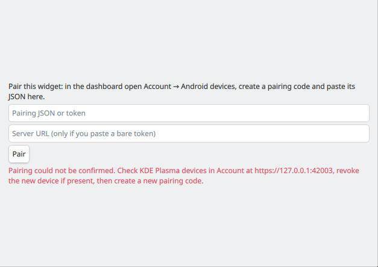
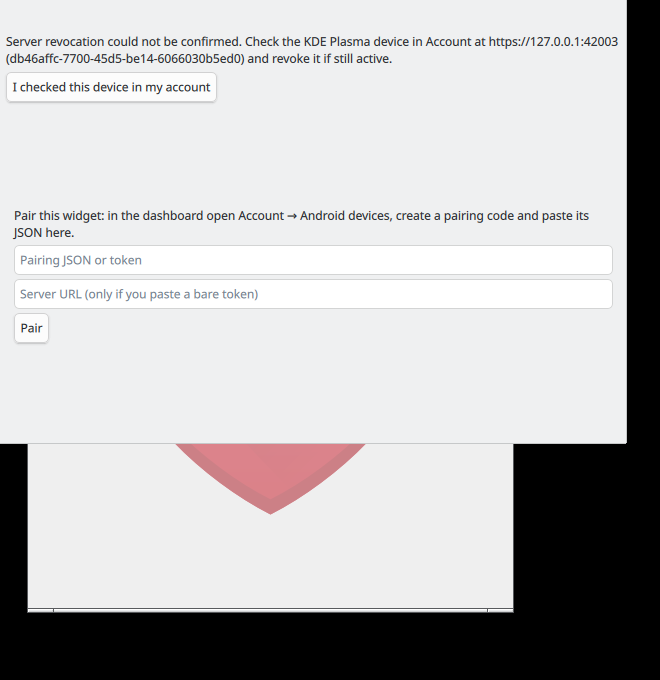
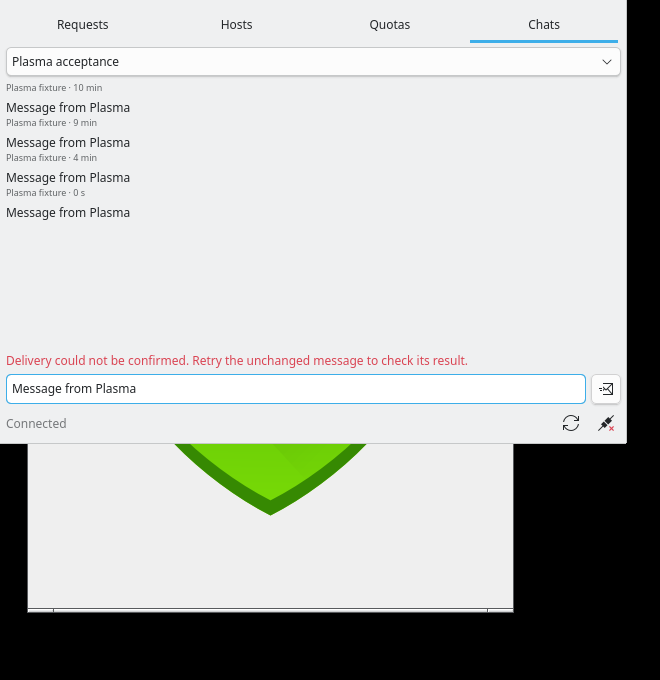
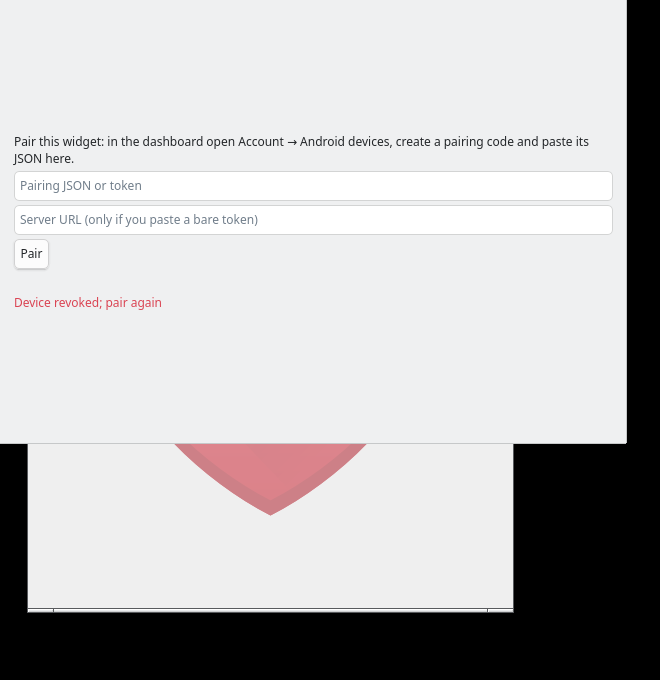

# Plasma widget acceptance

**Result, 21 November 2026.** Widget 0.2.0 paired with a real isolated owner over TLS, survived a desktop session restart, sent a persisted room message, safely retried a lost response and cleared access after the dashboard revoked its device. The old widget's globally keyed credential had no stored server identity and the old executable data-engine command embedded the new credential in its shell source during storage. The updated widget binds credentials to their server and applet and hands the value to a one-shot process on the user's D-Bus. The helper writes to libsecret's client via stdin.

## Findings and decisions

| ID | Reachable behaviour | Change and evidence |
| --- | --- | --- |
| PL-001 | Pairing invoked a shell command containing the bearer. All widgets used the same Secret Service attribute. The source persisted the server URL before the exchange or keyring write succeeded. | Store over a temporary session D-Bus service and `secret-tool` stdin. Check Gio, the CLI and the service before redeeming the one-time code. Read back the stored value before persisting the confirmed origin. On a failed write revoke the new device, or tell the user to revoke it if the server outcome is uncertain. The helper's idle timeout is 95 s; the keyring subprocess has a 90 s timeout. Scoped lookup, restart and explicit legacy replacement were exercised. |
| PL-002 | A revoked credential caused an extra unauthorized DELETE. Parallel poll callbacks could overwrite the revocation message or repopulate state. The old code kept the last room, quota rows and fleet window in memory. | The first 401 invalidates the session generation, clears its data, drops the local key and saves the unpaired state. Later replies from that generation are discarded. A user-initiated disconnect clears local access immediately and asks the original server to revoke the specific device once. A 2xx or 401 reply resolves the durable, nonsecret reminder. Any other outcome leaves the origin and device ID visible until the operator checks the account. The four in-flight requests in the first revocation check received 401. Across the fixture lifecycle, twelve 401 responses generated zero repeated DELETEs. The visible result was “Device revoked; pair again”. |
| PL-003 | The room chooser displayed the first title with the composer disabled before an actual selection. Sending cleared the draft immediately and used a new request ID on each click. | Show the selected room only after actual selection. Keep the text and request ID until confirmation, and show a retry instruction on an uncertain outcome. The production RoomHistory component fences older replies and their seen receipts, including reads within one room, return to an earlier room and reconnect after clearing state. Unknown quota samples omit the progress bar. Replay was verified by counting received HTTP POSTs, request IDs and persisted room events. |

The previous room-read function failed all three Qt Quick regressions. The final component passed all three with inverted callback order (five framework cases including initialization and cleanup). A slow valid response can still progress before a newer pending read completes.

## Real internal integration

The reviewed code was the integration worktree at `ece1d79d0a6f` plus the Plasma 0.2.0 change set. On Fedora 43 x86-64 (`biest.eulie.de`), the test installed the KPackage into a private XDG data directory and used `plasmawindowed` 6.7.5, Qt 6.10.3, Openbox, Xvfb 660×680, a private session D-Bus, GNOME Keyring and libsecret 0.21.8. The full Fastify owner ran against its own freshly migrated MySQL 8.4.13 schema. A loopback HTTPS proxy presented a certificate from a test-only CA mounted into the widget's private namespace. The OS's trust roots and the operator's wallet were untouched. All desktop input used `xdotool`. A synthetic admin issued pairing codes, created the room and revoked individual devices.

1. Installed the 0.1.0 KPackage from commit `480a20e42`. Supplied an admin-issued code through the actual widget. Observed HTTP 200 for pairing, approvals, rooms and quotas. A message entered via the widget appeared in the real admin room read.
2. Installed 0.2.0 at the same server, with the original credential still in the private keyring and the old device still valid. The upgrade displayed a request to re-pair. A full polling interval left the owner's request count at 63. Revoked exactly the earlier device in the admin API, redeemed a fresh code in the UI and checked the scoped entry against the original server and applet ID. The legacy entry remained present.
3. Terminated the applet and the entire fixture X11/D-Bus session. Opened a new one with the same encrypted test keyring and Plasma config. A different `plasmawindowed` PID read the scoped key and displayed Connected. The server observed authenticated requests without another pairing exchange. Read-back of the test credential found its bytes absent in Plasma config. The helper contract additionally checked the bytes arriving on stdin and the complete argument list.
4. Opened Chats, selected the room and sent a message. The proxy read the owner's successful response and deliberately dropped the downstream connection before the widget received it. The widget retained the draft and displayed the recovery instruction. An unchanged retry used the same ID. Across four scenarios, including the final package with the room-read fence, eight sends used four IDs and produced exactly four persisted room events.
5. Revoked the paired device in the dashboard API and refreshed. The first 401 returned the widget to pairing. A fresh private session verified exact-origin lookup and local clearing. The server retained the revoked device audit record.
6. Removed the save helper from the installed test package, then clicked Pair. The UI reported its dependency requirement. The wire count stayed at three redemptions. Restored the helper and clicked Pair again with the unchanged code; the fourth redemption succeeded.
7. In a separate fault run, the scoped helper could start and receive the value but could not open its OS output sink. After a successful pairing exchange the widget revoked the just-created device over HTTPS (DELETE 200). The targeted D-Bus contract also checks a failed secret-tool process and invalid input.

8. Dropped the response to the initial pairing POST after the real owner issued the device. The UI named the original server, instructed the operator to check and revoke the new KDE Plasma device and request a fresh code, and cleared the spent code. The owner saw exactly one POST and no subsequent authenticated requests from that attempt. The fixture administrator revoked the orphan.
9. Disconnected a paired widget from its real UI after arming the proxy to drop the reply to the DELETE. MySQL recorded a revoked device and the scoped keyring lookup was empty. Before and after a full private desktop restart, the owner had seen exactly one DELETE for that device. The widget displayed the original origin and device ID after restart. Acknowledging the reminder cleared it. With two fresh pairings, a normal DELETE 200 and a DELETE 401 after an admin revocation both removed the reminder. Across this dedicated five-device run all five devices were revoked, with three DELETEs on the companion endpoint (200 with lost reply, 200, 401).

## Repeatable checks and limits

From the repository root, run `python3 plasmoid/test/credential_store.py` (two tests including three D-Bus handoff cases), `ruff check plasmoid`, `QT_QPA_PLATFORM=offscreen /usr/lib64/qt6/bin/qmltestrunner -input plasmoid/test` and `qmllint-qt6 plasmoid/org.codex.orchestrator/contents/ui/*.qml`. The contract creates a private session bus and substitutes a recorder for secret-tool. The real keyring and GUI runs above are separate. QML lint exited zero with unqualified-context warnings; the original QML also reported this class of warning. [Installation and upgrade procedure](../../plasmoid/README.md)

This is a real Plasma/Secret Service/client-to-owner acceptance with synthetic data. There was no physical keyboard accessibility or screenreader audit, real desktop notification delivery, KWallet-specific backend run, real provider, production migration or active operator account in this test. The 6.2 dependency floor is based on KDE's published module; only 6.7.5 was executed. [KDE Plasma 6.2 D-Bus module](https://github.com/KDE/plasma-workspace/tree/v6.2.0/components/dbus)
